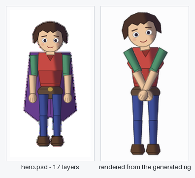
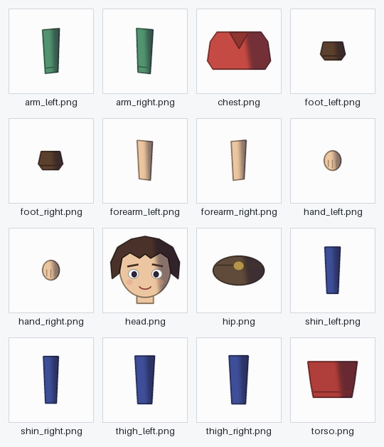
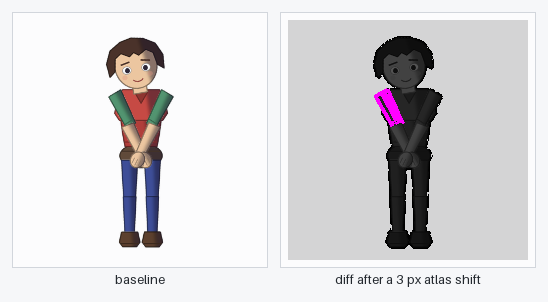
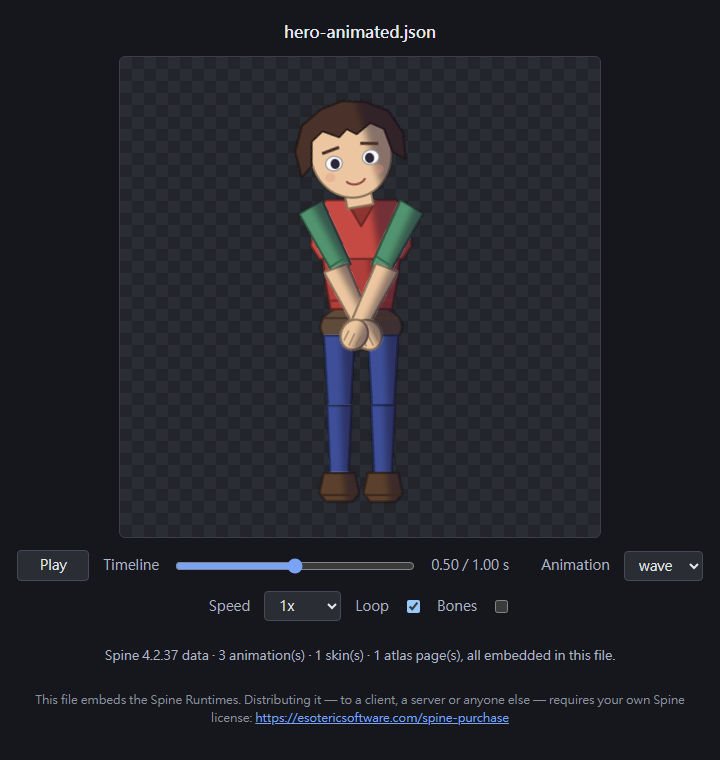
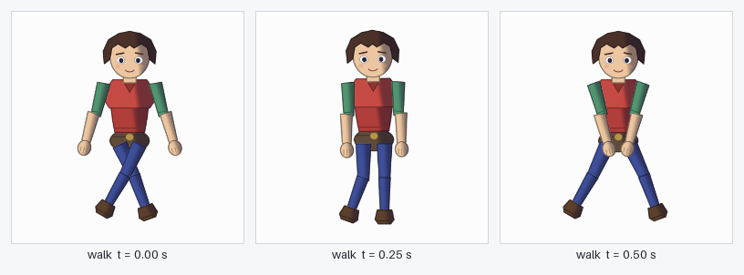

# kiro-spine2d-accelerator

A Kiro Power for working with [Spine](https://esotericsoftware.com) 2D assets: turn layered
artwork into a riggable skeleton, inspect and lint exported skeleton data, render and diff frames
headlessly, orchestrate the Spine CLI, and scaffold runtime integration for Unity, web and Godot.

[繁體中文](README_ZH.md) · [简体中文](README_CN.md) · [日本語](README_JP.md) · [한국어](README_KR.md)



*Left: `demo/out/hero.psd`, 17 layers drawn by `demo/make-sample-psd.py`. Right: a frame rendered
from the 20-bone skeleton and atlas that `psd_to_skeleton` generated from it, with no Spine editor
involved. Notice the purple cape is gone on the right: `cape` matches no known body part, so the
tool reports it as skipped instead of guessing where it belongs.*

## What this is

Two layers, installed together.

**A knowledge layer.** [`POWER.md`](POWER.md) plus the 13 domain guides in [`steering/`](steering)
— export automation, texture packing, lint rules, visual regression, per-engine integration,
version compatibility, CI. The AI reads these before it acts, so it starts from the documented
behaviour of the format rather than from a guess.

**An execution layer.** An MCP server over stdio exposing 22 tools.

Spine has no in-editor API. Its only official automation surface is the command line, which starts
a *separate* Spine process, performs one whole-file operation, and exits — you cannot drive an open
editor window, add a bone, or select a slot. So the execution layer does the two things that are
actually available: it wraps the official CLI, and it works directly on the documented data formats
(`.json` skeleton exports, `.atlas`, `pack.json`, export settings).

## Why it is worth anything

### Artwork to a riggable skeleton, without opening the editor

`psd_to_skeleton` reads a layered PSD, matches each layer against a table of body parts, builds the
bone chain with pivots at the joint edges, packs the parts into an atlas, and writes the skeleton
JSON. The image above is that path end to end. It needs no Spine licence, because it never launches
Spine.



*The `generated/images/` folder: one PNG per attachment, named after it. This is the folder that
makes `File -> Import Data` work — the Spine editor resolves each attachment as
`<skeleton.images>/<attachmentName>.png` next to the imported JSON and never reads the `.atlas`.
Without it the editor opens on a blank canvas and says nothing.*

### Automated visual checks that catch what the data cannot show

Repacking an atlas moves regions by a few pixels. The skeleton JSON does not change by one byte, so
a text diff, a hash comparison and a lint pass all report that nothing happened.



*Left: the recorded baseline. Right: the diff `visual_regression` wrote after one atlas region was
shifted by 3 pixels, the way a repack would. The magenta pixels are the regression. Everything
grey is unchanged. In the demo this gate fails 4 of 4 frames at 0.89–0.91 % of pixels and exits
non-zero, which is what a CI job needs.*

### Data inspection, linting and semantic diffing

`skeleton_inspect` reports bones and hierarchy depth, slots and blend modes, skins, attachment
types, mesh vertex counts, constraints, events, animation durations and timeline counts — and
cross-checks the regions the skeleton needs against the regions the atlas provides. A region the
skeleton asks for and the atlas lacks renders as nothing, with no error anywhere; that check is the
one worth running on every export.

`skeleton_diff` separates "the hash changed" from "the data changed". `skeleton_lint` applies
structural invariants, naming rules and budgets, attaches a fix to every finding, and gates CI.

### A rig you can look at and hand over



*`preview_export_html` writes one self-contained HTML file — runtime, skeleton, atlas and page
images embedded as data URLs, nothing fetched. The control strip is play/pause, a timeline scrub,
an animation selector, speed, loop and a debug-bones toggle. Here it is paused and scrubbed to
0.50 s of a 1.00 s animation. The file embeds the Spine Runtimes, so handing it to anyone needs
your own Spine licence; see [Licensing](#licensing).*

### Placeholder motion to review the rig with



*Three moments of a `walk` written by `skeleton_animate`. It is enough to see whether the pivots,
the draw order and the hierarchy survive movement, which is the question a rig review asks. It is
not animation: see [Honest limits](#honest-limits).*

### Per-engine scaffolding, and a licence boundary that fails early

`runtime_scaffold` emits the renames each runtime requires (spine-unity will not import a plain
`.atlas`; it has to be `.atlas.txt`), a controller with a mix table derived from this skeleton's own
animations, and a README of the steps.

Operations a Spine trial blocks — save, export, pack, unpack, import, clean up — are refused by
`capability-gate` *before* a process is spawned, with the exact command line printed:

```
CAPABILITY_DENIED: Blocked operations: exporting skeleton data (export).
Hint: Purchase a Spine license (Essential or Professional) and install the licensed build.
{
  "edition": "trial",
  "capability": "canExport",
  "wouldHaveRun": "\"C:\\Program Files\\Spine Trial\\SpineTrial.com\" -i ...\\hero-animated.json -e binary"
}
```

That command line is the deliverable: once a licensed install is in place the same work repeats
verbatim.

## Setup

### Requirements

**Node.js 18 or newer** is the only hard requirement for the server itself.

```bash
npm install
npm run build        # tsc -> dist/
```

### Wiring it into Kiro, or any MCP client

This repository's own [`mcp.json`](mcp.json) is the reference shape:

```json
{
  "mcpServers": {
    "spine-mcp": {
      "command": "node",
      "args": ["./dist/server.js"],
      "transport": "stdio",
      "env": {
        "SPINE_EXECUTABLE": "",
        "SPINE_USER_DATA": ""
      },
      "disabled": false
    }
  }
}
```

The server speaks stdio and opens no network port, so there is no listening surface to
authenticate.

| Environment variable | What it is for | Left empty |
|---|---|---|
| `SPINE_EXECUTABLE` | Explicit path to the Spine CLI binary. On Windows point it at the `.com` build — that is the one that returns an exit code; the `.exe` does not. | The server searches the standard install locations. If it finds nothing, the CLI-driven tools report that no installation was found and every data, generation and verification tool still works. |
| `SPINE_USER_DATA` | Explicit Spine user data directory, the one holding `spine.log`, `version.txt` and `examples/`. Edition and version detection read it. | Derived from whichever install was found. Without it, `spine_env_probe` cannot tell trial from licensed, so write tools refuse rather than assume. |
| `SPINE_WORKSPACE_ROOT` | Root that every write is confined to. Nothing is written outside it. | Defaults to the working directory. |

### Which capability needs what

Capabilities degrade one at a time; this is not all-or-nothing.

| To use | You need |
|---|---|
| `skeleton_inspect`, `atlas_inspect`, `skeleton_diff`, `skeleton_lint`, `export_settings_build`, `pack_settings_build`, `runtime_scaffold`, `skeleton_animate` | Nothing beyond Node. No Spine installation, no licence. |
| `psd_to_skeleton` | [`uv`](https://docs.astral.sh/uv/) and Python — `uv sync --project python` |
| `render_preview`, `preview_export_html`, `visual_regression`, and the measured-influence section of `skeleton_document` | The optional dependencies `@esotericsoftware/spine-webgl` (pinned 4.2.120) and `playwright-core` (pinned 1.62.0), plus a Chromium build: `npx playwright-core install chromium`. `preview_export_html` needs only the runtime, not the browser. |
| `spine_env_probe`, `spine_project_info`, `spine_export_settings_capture` | A Spine editor installation. A trial is enough. |
| `spine_export`, `spine_pack`, `spine_unpack`, `spine_import`, `spine_cleanup`, and `spine_batch` when it carries one of those | A **licensed** Spine. The trial blocks exactly this family. |

A missing optional dependency produces a `DEPENDENCY_MISSING` error naming the command that fixes
it, not a stack trace:

```
DEPENDENCY_MISSING: Chromium failed to launch (...). Install the browser with: npx playwright-core install chromium
Headless preview needs playwright-core plus a Chromium build. Everything else in this Power works without them.
```

### One gotcha worth knowing before it costs you an hour

**Close the Spine editor before running a CLI-driven tool.** With an editor window open, the
launcher hands the request to the running instance, prints `Started.`, and never returns. The tools
here all carry a timeout and report `CLI_TIMEOUT` with that explanation, but the fix is to close the
editor.

## Quick start

```bash
npm install
npm run build
node demo/run-demo.js        # or: npm run demo
```

Ten steps in about five seconds, driving the real server over stdio and narrating itself: the
environment probe, PSD to rig, inspect and lint, a semantic diff, four rendered frames, a baseline,
a deliberately shifted atlas caught with diff images, a Unity scaffold, the licensing refusal, and
the self-contained HTML page. It needs **no Spine licence**, writes only into `demo/out/`, and
resets that folder on every run. Without `uv` it synthesises a small rig instead of reading a PSD;
without Chromium it skips the three visual steps and says so.

[`demo/README.md`](demo/README.md) is the walk-through, with what to say at each step
([繁體中文](demo/README_ZH.md) · [简体中文](demo/README_CN.md) · [日本語](demo/README_JP.md) ·
[한국어](demo/README_KR.md)).

## The 22 tools

### CLI orchestration

| Tool | Needs a licence |
|---|---|
| `spine_env_probe` — edition, version, capability matrix, runtime branch, sidecar state | no |
| `spine_project_info` — Spine version, skeleton and animation counts | no |
| `spine_export` — export skeleton data | yes |
| `spine_pack` / `spine_unpack` — texture atlas packing | yes |
| `spine_import` — import data into a `.spine` project | yes |
| `spine_cleanup` — animation clean up, saves the project; needs `confirm: true` | yes |
| `spine_export_settings_capture` — write out a project's real export settings | no |
| `spine_batch` — several commands in one invocation | depends |

### Data layer (no Spine installation required)

| Tool | What it gives you |
|---|---|
| `skeleton_inspect` | Bones and depth, slots and blend modes, skins, attachment types, mesh vertex counts, constraints, events, animation durations and timeline counts, nonessential-data presence, and an optional atlas cross-check |
| `atlas_inspect` | Pages, formats, filters, premultiplied alpha, rotated and stripped regions, packing efficiency, duplicates, non power-of-two pages |
| `skeleton_diff` | Semantic diff of two exports, separating "the hash changed" from "the data changed" |
| `skeleton_lint` | Structural invariants, naming, budgets, export settings and atlas problems, each with a fix. Gates CI |
| `export_settings_build` | Export settings by template diff, refusing unknown keys |
| `pack_settings_build` | `pack.json` with every documented field validated |

### Generation, verification, integration

| Tool | What it does |
|---|---|
| `psd_to_skeleton` | Layered PSD to skeleton JSON + atlas + page image + a `generated/images/` folder of loose per-attachment PNGs, then inspect and lint the result |
| `skeleton_animate` | Generate `idle`, `walk`, `wave`, `jump` or `turn_head` into an exported rig, writing a second JSON file. A rig missing a required bone fails with the bones it does have rather than substituting one. This is mechanically plausible placeholder motion, not artist quality — linear keyframes, no curve shaping, no secondary motion, no weight shift, no foot locking. Open it in the Spine editor to refine it. |
| `render_preview` | Render animation frames with spine-ts in headless Chromium, reporting per-frame pixel coverage so "it silently rendered nothing" is detectable |
| `visual_regression` | Compare against baselines, write diffs, gate on failure |
| `preview_export_html` | One self-contained HTML file that plays the skeleton in any browser, with play/pause, a timeline scrub, an animation selector, speed, loop and debug bones. Runtime, skeleton, atlas and page images embedded — no server, nothing fetched. Distributing it needs your own Spine licence |
| `skeleton_document` | Write a `.spine-doc.md` and `.spine-doc.json` saying what a rig does: hierarchy with world transforms, constraints resolved per bone from the data, per-bone influence measured by re-rendering, and a motion profile per animation. Records a content fingerprint, because `skeleton.hash` alone does not detect change |
| `runtime_scaffold` | Per-target file naming, controller code with a mix table, and a README |

## Two tools, in their own words

Both of these ran on the demo's generated rig.

`skeleton_document` on `hero.json` + `hero.atlas` reports 20 bones (depth 8), 16 slots, 1
animation, 0 constraints, and 20 probes in `rotate` mode in 0.7 s with no bones found to have no
visible effect. It writes `hero.spine-doc.md` — a bone-hierarchy tree, a per-bone geometry table,
and a measured-influence table — plus the same data as JSON. Two rows of that table, abridged:

```
head        -> head 0.0386        [overlap] chest
thigh_left  -> thigh_left, shin_left, foot_left
               [overlap] hip, thigh_right, hand_left, forearm_left
```

The `[overlap]` label is the point. Influence is measured by perturbing one bone and comparing
axis-aligned bounding boxes, so a slot whose box merely overlaps a moved one is flagged as an
artefact of that measurement rather than reported as having moved.

`skeleton_animate` with `animations: [{template: 'idle'}, {template: 'wave'}, {template: 'walk'}]`
writes three animations into a second file — `idle` 2.00 s intended to loop on 6 bones, `wave`
1.00 s one-shot on 5 bones, `walk` 1.00 s intended to loop on 8 bones, 19 timelines and 79
keyframes in total. It preserves the existing `setup` animation and recomputes `skeleton.hash`,
naming the algorithm in the file as this project's own rather than the editor's.

## A walk through

```
spine_env_probe                       # what can this machine actually do?
skeleton_inspect  input, atlas        # what is in the data, and does the atlas cover it?
skeleton_lint     input, atlas        # is it correct, by team rules and budgets?
render_preview    skeleton, atlas     # does it render?
visual_regression skeleton, atlas     # does it still look the same?
preview_export_html skeleton, atlas   # one file a client opens, no server
runtime_scaffold  target=unity        # what does the engine need?
```

Everything above works on a trial licence. Export, pack and import need a purchased one.

## CI

`templates/ci/` ships a GitHub Actions workflow and a PowerShell script, and `dist/ci-cli.js`
exposes the same gates as subcommands:

```bash
node dist/ci-cli.js lint       --export-dir export --fail-on error
node dist/ci-cli.js regression --export-dir export --baseline-dir baseline --diff-dir diff
node dist/ci-cli.js export     --projects-dir art --out-dir export --update 4.2.xx
node dist/ci-cli.js diff       --from old.json --to new.json
```

Exit codes: 0 pass, 1 gate failed, 2 usage or operational error. The default CI shape assumes the
exported artifacts are committed, so the runner needs no licence — see `steering/ci-pipeline.md`.

## Honest limits

- **Generated animation is placeholder motion.** `skeleton_animate` writes mechanically plausible
  placeholder motion, not artist quality — linear keyframes, no curve shaping, no secondary motion,
  no weight shift, no foot locking. Open it in the Spine editor to refine it. There is also no mesh
  deformation.
- **Generated rigs are region attachments only.** No weighted meshes, no IK, no transform
  constraints. Weights, meshes and hand animation belong in the editor; this is the step before it.
- **The export / pack / import family is unverified against a licensed install.** The project was
  developed on a trial. Command lines are assembled, capability-gated and unit-tested, but no
  successful licensed run has been observed here.
- **Influence is measured by bounding box.** `skeleton_document` perturbs one bone at a time and
  compares axis-aligned slot boxes, so credits to bones in another subtree are labelled
  `[overlap]` — an artefact of the measurement, not movement.
- **Verification so far is single-platform.** Everything visual was confirmed on win32 x64,
  Windows 10.0.19045, Node v24.14.0, playwright-core 1.62.0, Chromium 151.0.7922.34,
  `@esotericsoftware/spine-webgl` 4.2.120. Nothing has been verified on macOS, Linux, or another
  GPU/driver combination.
- **Binary `.skel` is out of scope.** The data layer reads JSON exports.
- **Export settings field names are not publicly documented.** The templates are shaped from the
  documented dialog; calibrate them with `spine_export_settings_capture`. `pack.json` has no such
  gap.
- **Godot integration is unrun.** The naming rules and install paths come from Esoteric's docs; no
  Godot project has consumed the output.

| Verified against the real thing | How |
|---|---|
| Trial detection, capability matrix, CLI `--version` | A real Spine 4.3.26 Trial install |
| The editor-handoff hang | Reproduced, then encoded as a timeout with a specific hint |
| Headless rendering, determinism, regression detection | Real headless Chromium |
| PSD to skeleton + atlas | A real PSD file built with psd-tools |
| Python sidecar bridge | A real `uv run` round trip |

| Not yet verified | Why |
|---|---|
| Export / pack / import / clean-up succeeding | No licensed editor available here |
| Export settings field names | Not publicly documented; calibrate with `spine_export_settings_capture` |
| Binary `.skel` parsing | Out of scope for now |
| Godot integration | Rules taken from the docs, not run against a project |
| Anything beyond one platform and one Chromium | Single-platform verification, as listed above |

## Repository layout

```
POWER.md              the Power definition: architecture, behaviours, tool surface, workflows
steering/             13 domain guides the AI reads before acting
templates/            export-settings, pack-settings, lint-rules, ci
hooks/                prompt-submit hook that activates the Power
src/                  the execution layer (TypeScript, stdio MCP server)
python/               PSD to rig sidecar (uv, psd-tools, Pillow, rectpack)
docs/images/          the screenshots on this page, and the script that regenerates them
demo/                 the two-minute scripted demo
tests/                unit, property and integration tests
```

## Development

```bash
npm run typecheck
npm test                         # 41 suites, 915 tests
npm run test:unit
npm run test:integration         # exercises the real Spine CLI and real Chromium when present
uv run --project python pytest   # 89 tests
```

Integration tests skip themselves when Spine or Chromium is absent, so the suite stays green on a
bare machine. The opt-in `SPINE_CLI_LIVE=1` tier additionally requires every Spine editor window to
be closed.

### Regenerating the images on this page

Every image in `docs/images/` is output from this project, produced by one script:

```bash
npm run build
npm run docs:images        # node docs/make-doc-images.mjs
```

It runs `demo/run-demo.js`, drives the server over stdio for the generated walk, screenshots
`demo/out/preview/hero.html` in Chromium, and composes the labelled strips with Pillow
([`docs/compose-doc-images.py`](docs/compose-doc-images.py)). Pass `--skip-demo` to reuse an
existing `demo/out/`. It needs everything the demo needs, so it fails rather than committing a
half-regenerated set. No external artwork is read: every pixel starts in
`demo/make-sample-psd.py` or in a frame rendered from it.

## Licensing

This repository is MIT licensed — see [LICENSE](LICENSE).

Spine itself is commercial software by Esoteric Software, and the Spine Runtimes carry their own
licence. **A Spine editor licence is required at the time the Spine Runtimes are integrated into a
product**, and after that the product may continue to be distributed even if the licence later
expires. Integrating the Runtimes into a development tool, SDK or library free of charge is
explicitly allowed, but **every user of that tool needs their own Spine licence and must be told
so.** A Spine licence is needed to distribute any software containing the Spine Runtimes, even when
the Spine editor itself is not used.

This repository never vendors the runtime: `@esotericsoftware/spine-webgl` is an
`optionalDependency` installed from npm, and no Spine code, runtime or example asset is
redistributed here. The HTML file `preview_export_html` writes embeds that runtime, so distributing
that file needs your own licence.

See https://esotericsoftware.com/spine-purchase.
