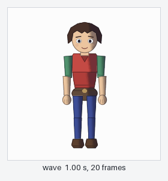
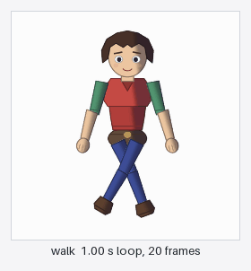

# kiro-spine2d-accelerator

[Spine](https://esotericsoftware.com) 2D のアセット作業向け Kiro Power。レイヤー分けされた絵を
リグ可能なスケルトンに変換し、エクスポート済みスケルトンデータを検査・lint し、ヘッドレスで
描画して差分を取り、Spine CLI をオーケストレーションし、Unity／Web／Godot 向けのランタイム統合の
足場をつくります。

[English](README.md) · [繁體中文](README_ZH.md) · [简体中文](README_CN.md) · [한국어](README_KR.md)


*左: `demo/out/hero.psd`。17 レイヤーすべてを `demo/make-sample-psd.py` が手続き的に描画しています。
右: `psd_to_skeleton` がそこから生成した 20 ボーンのスケルトンと atlas で描いた 1 フレーム。
Spine エディタは一度も開いていません。右で紫のマントが消えていることに注目してください。`cape` は
既知の身体パーツに一致しないため、配置を推測せず「スキップした」と報告されます。*

## これは何か

2 つのレイヤーが一緒に入ります。

**知識レイヤー。** [`POWER.md`](POWER.md) と [`steering/`](steering) にある 13 本のドメインガイド
—— エクスポート自動化、テクスチャパッキング、lint ルール、ビジュアルリグレッション、エンジンごとの
統合、バージョン互換性、CI。AI は行動前にこれを読むので、推測ではなく文書化された挙動から始まります。

**実行レイヤー。** stdio で動く MCP サーバー。22 個のツールを公開します。

**Spine にはエディタ内 API がありません。** 公式の自動化手段はコマンドラインだけで、その動作は
「別の Spine プロセスを起動 → ファイル単位の操作を 1 つ実行 → 終了」です。開いているエディタ
ウィンドウを操作したり、ボーンを追加したり、スロットを選択したりはできません。そこで実行レイヤーは
実際に可能な 2 つだけを行います。公式 CLI をラップすること、そして文書化されたデータ形式
（`.json` のスケルトンエクスポート、`.atlas`、`pack.json`、エクスポート設定）を直接扱うことです。

## 何の役に立つのか

### エディタを開かずに、絵からリグ可能なスケルトンへ

`psd_to_skeleton` はレイヤー PSD を読み、各レイヤーを身体パーツの表と突き合わせ、関節の縁を支点に
ボーンチェーンを組み、パーツを atlas にパックし、スケルトン JSON を書き出します。上の画像がその
経路の始点と終点です。Spine を一度も起動しないので、Spine ライセンスは要りません。



*同じ生成されたリグが動いている様子: デモの 1.00 秒 `wave` の 20 フレームを、
`generated/hero-animated.json` と隣の atlas から `render_preview` が 1 フレーム 50 ms で
描画したものです。全ピクセルが手続き的に描かれた PSD 由来で、Spine エディタは一度も開いていません。*


*`generated/images/` フォルダ: アタッチメント 1 つにつき PNG 1 枚、名前はそのアタッチメント名です。
`File -> Import Data` が成立するのはこのフォルダのおかげです。Spine エディタは各アタッチメントを
取り込んだ JSON の隣の `<skeleton.images>/<attachmentName>.png` として解決し、`.atlas` は読みません。
これが無いとエディタは空のキャンバスを開き、何も言いません。*

### データでは見えない変化を捕まえる自動ビジュアル検査

atlas を再パックすると領域が数ピクセル動きます。スケルトン JSON は 1 バイトも変わらないので、
テキスト差分、ハッシュ比較、lint はそろって「何も起きていない」と報告します。


*左: 記録されたベースライン。右: atlas の 1 領域を再パック同様に 3 ピクセル動かしたあとに
`visual_regression` が書いた差分画像。マゼンタのピクセルがリグレッションで、灰色は変化なしです。
デモではこのゲートが 4 フレームすべてを失敗させ、差分はピクセルの 0.89–0.91% で、非ゼロ終了します。
CI が必要とするのはまさにこれです。*

### データの検査、lint、意味的な差分

`skeleton_inspect` はボーンと階層の深さ、スロットとブレンドモード、スキン、アタッチメント種別、
メッシュ頂点数、コンストレイント、イベント、各アニメーションの長さとタイムライン数を報告し、
さらに「スケルトンが要求する領域」と「atlas が提供する領域」を相互チェックします。スケルトンが
要求して atlas に無い領域は何も描かれず、どこにもエラーが出ません。このチェックは毎回の
エクスポートで走らせる価値があります。

`skeleton_diff` は「ハッシュが変わった」と「データが変わった」を分けます。`skeleton_lint` は構造
不変条件、命名規則、予算を適用し、各指摘に修正方法を添え、CI のゲートになります。

### 見せられて、そのまま渡せるリグ


*`preview_export_html` は自己完結した HTML を 1 枚書き出します。ランタイム、スケルトン、atlas、
ページ画像はすべて data URL として埋め込まれ、外部からは何も取得しません。コントロール列は
再生／一時停止、タイムラインのスクラブ、アニメーション選択、速度、ループ、ボーン表示です。ここでは
1.00 秒のアニメーションの 0.50 秒で一時停止しています。このファイルは Spine Runtimes を埋め込むため、
誰かに渡すには自分の Spine ライセンスが必要です。[ライセンス](#ライセンス) を参照してください。*

### リグをレビューするためのプレースホルダーのモーション



*`skeleton_animate` が書いた `walk` テンプレート、1.00 秒ループの 20 フレーム全部です。
下の 3 コマは同じ動きで、GIF を再生しない環境のために残しています。*


*`skeleton_animate` が書いた `walk` の 3 つの時点です。支点、描画順、階層が動かしても成立するかを
確認するには十分で、リグレビューが問うのはまさにそこです。これは完成したアニメーションでは
ありません。[正直な限界](#正直な限界) を参照してください。*

### エンジンごとの足場と、早く失敗するライセンス境界

`runtime_scaffold` は各ランタイムが要求するリネーム（spine-unity は素の `.atlas` を読み込めず、
`.atlas.txt` でなければなりません）、このスケルトン自身のアニメーションから導いた mix テーブル付きの
コントローラー、そして手順の README を出力します。

Spine の Trial が禁じる操作 —— 保存、export、pack、unpack、import、cleanup —— はプロセスが起動
される**前に** `capability-gate` が拒否し、実行しようとしたコマンドラインを出力します。

```
CAPABILITY_DENIED: Blocked operations: exporting skeleton data (export).
Hint: Purchase a Spine license (Essential or Professional) and install the licensed build.
{
  "edition": "trial",
  "capability": "canExport",
  "wouldHaveRun": "\"C:\\Program Files\\Spine Trial\\SpineTrial.com\" -i ...\\hero-animated.json -e binary"
}
```

そのコマンドラインこそ成果物です。ライセンス版を入れたあと、同じ作業をそのまま再実行できます。

## セットアップ

### 必要なもの

サーバー自体の必須要件は **Node.js 18 以上** だけです。

```bash
npm install
npm run build        # tsc -> dist/
```

### Kiro や任意の MCP クライアントへの接続

このリポジトリ自身の [`mcp.json`](mcp.json) が参照用の形です。

```json
{
  "mcpServers": {
    "spine-mcp": {
      "command": "node",
      "args": ["./dist/server.js"],
      "transport": "stdio",
      "env": {
        "SPINE_EXECUTABLE": "",
        "SPINE_USER_DATA": ""
      },
      "disabled": false
    }
  }
}
```

サーバーは stdio のみで通信し、ネットワークポートを開かないため、認証が必要な待ち受け面はありません。

| 環境変数 | 用途 | 空のままにした場合 |
|---|---|---|
| `SPINE_EXECUTABLE` | Spine CLI 実行ファイルの明示パス。Windows では `.com` を指してください。exit code を返すのはそちらで、`.exe` は返しません。 | サーバーが標準のインストール先を自分で探します。見つからなければ CLI 系ツールが「インストールが見つからない」と報告し、データ層・生成・検証のツールはすべてそのまま動きます。 |
| `SPINE_USER_DATA` | Spine のユーザーデータディレクトリの明示パス。`spine.log`、`version.txt`、`examples/` がある場所で、エディションとバージョンの判定がこれを読みます。 | 見つかったインストールから導出します。どうしても得られない場合、`spine_env_probe` は Trial と製品版を区別できないため、書き込み系ツールは推測せず拒否します。 |
| `SPINE_WORKSPACE_ROOT` | すべての書き込みをこのルート内に閉じ込めます。外には書きません。 | 既定は作業ディレクトリです。 |

### どの機能に何が必要か

機能は 1 つずつ劣化します。全部か無しかではありません。

| 使いたいもの | 必要なもの |
|---|---|
| `skeleton_inspect`、`atlas_inspect`、`skeleton_diff`、`skeleton_lint`、`export_settings_build`、`pack_settings_build`、`runtime_scaffold`、`skeleton_animate` | Node 以外は不要。Spine のインストールもライセンスも要りません。 |
| `psd_to_skeleton` | [`uv`](https://docs.astral.sh/uv/) と Python —— `uv sync --project python` |
| `render_preview`、`preview_export_html`、`visual_regression`、および `skeleton_document` の実測影響範囲のセクション | 任意依存の `@esotericsoftware/spine-webgl`（4.2.120 固定）と `playwright-core`（1.62.0 固定）、加えて Chromium: `npx playwright-core install chromium`。`preview_export_html` はランタイムだけで足り、ブラウザは不要です。 |
| `spine_env_probe`、`spine_project_info`、`spine_export_settings_capture` | Spine エディタのインストール。Trial でも足ります。 |
| `spine_export`、`spine_pack`、`spine_unpack`、`spine_import`、`spine_cleanup`、およびそれらを含む `spine_batch` | **ライセンス版**の Spine。Trial が止めるのはちょうどこの一群です。 |

任意依存が無い場合はスタックトレースではなく、直し方のコマンドを名指しした
`DEPENDENCY_MISSING` エラーが返ります。

```
DEPENDENCY_MISSING: Chromium failed to launch (...). Install the browser with: npx playwright-core install chromium
Headless preview needs playwright-core plus a Chromium build. Everything else in this Power works without them.
```

### 1 時間を失う前に知っておく価値のある落とし穴

**CLI 系ツールを動かす前に Spine エディタを閉じてください。** エディタウィンドウが開いていると、
ランチャーは要求を既存のインスタンスに渡し、`Started.` を出力したまま戻りません。ここのツールは
すべてタイムアウトを持ち、その説明付きで `CLI_TIMEOUT` を報告しますが、直す方法はエディタを
閉じることです。

## クイックスタート

```bash
npm install
npm run build
node demo/run-demo.js        # または: npm run demo
```

10 ステップ、約 5 秒。実際のサーバーを stdio で駆動しながら自分で解説します。環境プローブ、
PSD からリグ、検査と lint、意味的な差分、4 フレームの描画、ベースライン、わざと動かした atlas を
差分画像で検出、Unity の足場、ライセンス拒否、そして自己完結 HTML ページ。**Spine ライセンスは
不要**で、書き込みは `demo/out/` だけ、しかも実行ごとにそのフォルダをリセットします。`uv` が
無ければ PSD の代わりに小さなリグを合成し、Chromium が無ければ 3 つの視覚ステップを飛ばして
そう述べます。

各ステップで何を言うかは [`demo/README_JP.md`](demo/README_JP.md) にあります
（[English](demo/README.md) · [繁體中文](demo/README_ZH.md) · [简体中文](demo/README_CN.md) ·
[한국어](demo/README_KR.md)）。

## 22 個のツール

### CLI オーケストレーション

| ツール | ライセンス必要 |
|---|---|
| `spine_env_probe` — バージョン、エディション、機能マトリクス、ランタイムブランチ、サイドカー状態 | 不要 |
| `spine_project_info` — プロジェクトの Spine バージョン、スケルトン数、アニメーション数 | 不要 |
| `spine_export` — スケルトンデータのエクスポート | **必要** |
| `spine_pack` / `spine_unpack` — テクスチャ atlas のパック／アンパック | **必要** |
| `spine_import` — データを `.spine` プロジェクトへインポート | **必要** |
| `spine_cleanup` — アニメーションのクリーンアップ。プロジェクトを保存するため `confirm: true` が必要 | **必要** |
| `spine_export_settings_capture` — プロジェクトの実際のエクスポート設定を書き出す | 不要 |
| `spine_batch` — 複数コマンドを 1 回の呼び出しに | 内容次第 |

### データレイヤー（Spine のインストール不要）

| ツール | 得られるもの |
|---|---|
| `skeleton_inspect` | ボーンと階層の深さ、スロットとブレンドモード、スキン、アタッチメント種別、メッシュ頂点数、コンストレイント、イベント、各アニメーションの長さとタイムライン数、nonessential data の有無、任意で atlas との相互チェック |
| `atlas_inspect` | ページ、フォーマット、フィルター、premultiplied alpha、回転・余白除去された領域、充填率、名前の重複、2 のべき乗でないページ |
| `skeleton_diff` | 2 つのエクスポートの意味的な差分。「ハッシュが変わった」と「データが変わった」を区別します |
| `skeleton_lint` | 構造不変条件、命名、予算、エクスポート設定と atlas の問題。各項目に修正方法付き。CI のゲートに使えます |
| `export_settings_build` | テンプレート差分でエクスポート設定を生成。テンプレートに無いキーは拒否します |
| `pack_settings_build` | `pack.json` を生成。全フィールドを型・範囲・列挙値で検証します |

### 生成・検証・統合

| ツール | 内容 |
|---|---|
| `psd_to_skeleton` | レイヤー PSD → スケルトン JSON + atlas + ページ画像、さらにアタッチメントごとの個別 PNG が入った `generated/images/` フォルダ。生成後に検査と lint も実行 |
| `skeleton_animate` | 5 つのテンプレート（`idle`、`walk`、`wave`、`jump`、`turn_head`）から Spine 4.2 のアニメーションを生成し、別の JSON ファイルに書き出します。テンプレートが必要とするボーンが無ければ、別のボーンで代用せずに失敗し、リグが実際に持つボーン名を示します。これは機械的に妥当なプレースホルダーのモーションで、アーティストが仕上げた品質ではありません: 線形キーフレームのみ、カーブ調整なし、二次モーションなし、重心移動なし、足の固定なし。Spine エディタで開いて仕上げてください |
| `render_preview` | spine-ts をヘッドレス Chromium で動かしアニメーションのフレームを描画し、フレームごとのピクセル被覆率を報告して「無言で何も描かなかった」を検出可能にします |
| `visual_regression` | ベースラインと比較し、diff 画像を出力。失敗でゲートを閉じます |
| `preview_export_html` | すべてを内包した 1 枚の HTML ファイル。どのブラウザでもスケルトンを再生でき、再生／一時停止、タイムラインのスクラブ、アニメーション選択、速度、ループ、ボーン表示が使えます。ランタイム、スケルトン、atlas、ページ画像はすべて埋め込み済み —— サーバー不要、外部への取得もありません。このファイルを配布するには自分の Spine ライセンスが必要です |
| `skeleton_document` | `.spine-doc.md` と `.spine-doc.json` を書き出し、そのリグが何をするのかを説明します: ワールド変換付きの階層、データから解決したボーンごとのコンストレイント、再描画して実測したボーンごとの影響範囲、アニメーションごとのモーションプロファイル。内容の fingerprint も記録します。`skeleton.hash` だけでは変更を検出できないからです |
| `runtime_scaffold` | ターゲットごとのファイル名要件、mix テーブル付きのコントローラーコード、手順 README |

## 2 つのツール自身の出力

どちらもデモが生成したリグに対して実際に走らせた結果です。

`skeleton_document` を `hero.json` + `hero.atlas` に対して実行すると、20 ボーン（深さ 8）、
16 スロット、1 アニメーション、0 コンストレイント、`rotate` モードで 20 プローブを 0.7 秒で実行し、
「見える効果が無いボーン」は 1 本も無しと報告します。`hero.spine-doc.md`（ボーン階層のツリー、
ボーンごとの幾何テーブル、実測した影響範囲のテーブル）と同内容の JSON を書き出します。
そのテーブルの 2 行を抜粋します。

```
head        -> head 0.0386        [overlap] chest
thigh_left  -> thigh_left, shin_left, foot_left
               [overlap] hip, thigh_right, hand_left, forearm_left
```

`[overlap]` というラベルが要点です。影響範囲は 1 本のボーンを揺らして軸平行バウンディングボックスを
比べて測るので、動かした箱と単に重なっているだけのスロットは「動いた」と報告されるのではなく、
測定の副産物として印が付きます。

`skeleton_animate` に `animations: [{template: 'idle'}, {template: 'wave'}, {template: 'walk'}]` を
渡すと、3 つのアニメーションを 2 つ目のファイルに書き出します。`idle` は 2.00 秒でループを意図、
6 ボーン。`wave` は 1.00 秒のワンショット、5 ボーン。`walk` は 1.00 秒でループを意図、8 ボーン。
合計 19 タイムライン、79 キーフレームです。既存の `setup` アニメーションは保持し、`skeleton.hash` を
再計算して、そのアルゴリズムがエディタのものではなく本プロジェクト独自であることをファイル内に
明記します。

## 典型的な流れ

```
spine_env_probe                       # このマシンで実際に何ができるか
skeleton_inspect  input, atlas        # データの中身と、atlas に欠けた領域はないか
skeleton_lint     input, atlas        # チーム規約と予算に照らして正しいか
render_preview    skeleton, atlas     # 実際に描画されるか
visual_regression skeleton, atlas     # 見た目は変わっていないか
preview_export_html skeleton, atlas   # クライアントが開くだけの 1 ファイル、サーバー不要
runtime_scaffold  target=unity        # エンジン側に必要なものは何か
```

ここまではすべて trial ライセンスで動きます。export、pack、import には製品ライセンスが必要です。

## CI

`templates/ci/` に GitHub Actions ワークフローと PowerShell スクリプトがあり、`dist/ci-cli.js` が
同じゲートをサブコマンドとして公開します。

```bash
node dist/ci-cli.js lint       --export-dir export --fail-on error
node dist/ci-cli.js regression --export-dir export --baseline-dir baseline --diff-dir diff
node dist/ci-cli.js export     --projects-dir art --out-dir export --update 4.2.xx
node dist/ci-cli.js diff       --from old.json --to new.json
```

exit code は 0 が成功、1 がゲート失敗、2 が使い方または操作エラーです。既定の CI 構成はエクスポート
成果物がコミットされている前提なので、ランナーにライセンスは不要です（`steering/ci-pipeline.md` 参照）。

## 正直な限界

- **生成されるアニメーションはプレースホルダーです。** `skeleton_animate` が書き出すのは機械的に
  妥当なプレースホルダーのモーションで、アーティストが仕上げた品質ではありません: 線形キーフレーム
  のみ、カーブ調整なし、二次モーションなし、重心移動なし、足の固定なし、メッシュのデフォームなし。
  Spine エディタで開いて仕上げてください。ツール自身が出力する原文は
  `mechanically plausible placeholder motion, not artist quality — linear keyframes, no curve shaping, no secondary motion, no weight shift, no foot locking. Open it in the Spine editor to refine it.` です
- **生成されるリグはリージョンアタッチメントのみです。** ウェイト付きメッシュ、IK、トランスフォーム
  コンストレイントはありません。ウェイト、メッシュ、手付けのアニメーションはエディタの仕事で、
  ここはその一歩前です。
- **export / pack / import の一群はライセンス版で検証されていません。** 本プロジェクトは Trial で
  開発しました。コマンドライン組み立て、capability gate、ユニットテストは揃っていますが、
  ライセンス版での成功実行はここでは観測していません。
- **影響範囲はバウンディングボックスで測っています。** `skeleton_document` は 1 本ずつボーンを
  揺らして軸平行のスロット箱を比べるため、別のサブツリーのボーンへの寄与は `[overlap]` と
  ラベル付けされます。それは測定の副産物であって、動いたわけではありません。
- **今のところ検証は単一プラットフォームです。** 視覚に関わる部分はすべて win32 x64、
  Windows 10.0.19045、Node v24.14.0、playwright-core 1.62.0、Chromium 151.0.7922.34、
  `@esotericsoftware/spine-webgl` 4.2.120 で確認しました。macOS、Linux、その他の GPU／ドライバの
  組み合わせは何も検証していません。
- **バイナリ `.skel` は対象外です。** データレイヤーは JSON エクスポートを読みます。
- **エクスポート設定のフィールド名は公式に文書化されていません。** テンプレートはエクスポート
  ダイアログの文書から形作っており、`spine_export_settings_capture` で校正してください。
  `pack.json` にこの問題はありません。
- **Godot 統合は未実行です。** ファイル名規則とインストール経路は Esoteric の文書由来で、
  実際の Godot プロジェクトが出力を消費したことはありません。

| 実機で検証済み | 方法 |
|---|---|
| Trial 判定、機能マトリクス、CLI `--version` | 実際の Spine 4.3.26 Trial |
| エディタが CLI の要求を奪いハングする挙動 | 再現したうえで、タイムアウトと専用ヒントに実装 |
| ヘッドレス描画、決定性、リグレッション検出 | 実際のヘッドレス Chromium |
| PSD → スケルトン + atlas | psd-tools で生成した実際の PSD ファイル |
| Python サイドカーの橋渡し | 実際の `uv run` 往復 |

| 未検証 | 理由 |
|---|---|
| export / pack / import / cleanup の成功実行 | ここにライセンス版のエディタがありません |
| エクスポート設定のフィールド名 | 公式文書が無く、`spine_export_settings_capture` で校正してください |
| バイナリ `.skel` の解析 | 現時点では対象外です |
| Godot 統合 | 規則は文書由来で、実プロジェクトでは未実行です |
| 1 つのプラットフォームと 1 つの Chromium を超える範囲 | 上記のとおり検証は単一プラットフォームです |

## リポジトリ構成

```
POWER.md              Power の定義: アーキテクチャ、基本動作、ツール一覧、ワークフロー
steering/             AI が行動前に読む 13 本のドメインガイド
templates/            export-settings、pack-settings、lint-rules、ci
hooks/                この Power を有効化する promptSubmit フック
src/                  実行レイヤー（TypeScript、stdio MCP サーバー）
python/               PSD → リグのサイドカー（uv、psd-tools、Pillow、rectpack）
docs/images/          このページのスクリーンショットと、それを再生成するスクリプト
demo/                 2 分のスクリプト化されたデモ
tests/                ユニット、プロパティ、統合テスト
```

## 開発

```bash
npm run typecheck
npm test                         # 41 スイート、915 テスト
npm run test:unit
npm run test:integration         # Spine CLI と Chromium が存在すれば実際に実行します
uv run --project python pytest   # 89 テスト
```

統合テストは Spine や Chromium が無い環境では自動的にスキップされるため、クリーンなマシンでも
スイートはグリーンになります。`SPINE_CLI_LIVE=1` の任意層では、Spine エディタのウィンドウを
すべて閉じておく必要があります。

### このページの画像を再生成する

`docs/images/` の画像はすべて本プロジェクト自身の出力で、1 つのスクリプトが作ります。

```bash
npm run build
npm run docs:images        # node docs/make-doc-images.mjs
```

`demo/run-demo.js` を実行し、生成された walk のためにサーバーを stdio で駆動し、
`demo/out/preview/hero.html` を Chromium でスクリーンショットし、ラベル付きの帯と 2 つのループ
GIF を Pillow（[`docs/compose-doc-images.py`](docs/compose-doc-images.py)）で合成します。`--skip-demo` を渡すと
既存の `demo/out/` を再利用します。デモに必要なものすべてを必要とし、半分だけ再生成された状態を
残すのではなく失敗します。外部のアート素材は読みません。すべてのピクセルは
`demo/make-sample-psd.py` か、そこから描画されたフレームに由来します。

## ライセンス

このリポジトリは MIT です（[LICENSE](LICENSE) 参照）。

Spine 自体は Esoteric Software の商用ソフトウェアで、Spine Runtimes には独自のライセンスが
あります。**Spine Runtimes を製品に統合する時点で Spine エディターのライセンスが必要**で、
統合後はライセンスがあとで失効しても、その製品の配布を続けられます。Runtimes を無償で提供する
開発ツール、SDK、ライブラリに統合することは明確に許可されていますが、**そのツールの利用者は各自が
Spine ライセンスを保有する必要があり、その旨を伝えなければなりません。** Spine エディター自体を
使わない場合でも、Spine Runtimes を含むソフトウェアを配布するには Spine ライセンスが必要です。

このリポジトリはランタイムを同梱しません。`@esotericsoftware/spine-webgl` は npm から入れる
`optionalDependency` であり、Spine のコード、ランタイム、サンプルアセットを再配布していません。
`preview_export_html` が書き出す HTML ファイルはそのランタイムを埋め込むため、そのファイルを
配布するには自分のライセンスが必要です。

詳細は https://esotericsoftware.com/spine-purchase を参照してください。
